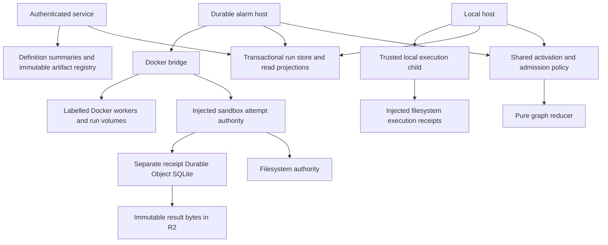

# Decision

Keep the pure graph reducer and transactional run store. Extract the execution receipt owners behind explicit contracts, share activation policy between the two hosts, and persist small read projections where the current API repeatedly reconstructs the same answer. Exercise the alternate persistence implementation through actual local Wrangler and Docker before integrating on main.

This proposal is grounded in `6ffecdfd60e16aaa335467684d918b3cd8b44813` and the three adjacent assessment notes. Those notes specify the detailed contracts, source paths and tests. This document selects scope and resolves the implementation boundaries. Fable reviewed it before production edits; the resolution below records the accepted corrections. Later implementation-review corrections are identified where they changed the design.

The user authorizes implementation, the repeated workload and final main integration. Actual cloud provisioning or execution remains gated. Existing personal state and previous test datasets must remain untouched.

## What went wrong and what this changes

| Failure category | Observed issue | Architectural response |
| --- | --- | --- |
| Execution knowledge | A Docker transport error could finish a receipt while its worker still ran | Keep transport failure distinct from terminal observations; immutable admission and terminal publication with explicit recovery |
| Lifecycle coverage | Owned suspended work lost scheduler selection; an invalid schedule blocked unrelated reconciliation | Preserve the repaired selectors and per-schedule isolation; test reconstruction and progress separately from reducer transitions |
| Duplicated host policy | Local and durable hosts differ on retry beside wait/sleep | One activation planner and admission decision; both retain retry/rate-limit slots |
| Notification contract | Queued creation waited for the five-second idle poll | Keep committed-event wake policy and fallback polling; rerun the daemon workload |
| Backend constraints | A 200-run page exceeded workerd's SQL binding cap; scope items still have the same problem | Fixed-size JSON-array bindings and real workerd boundary coverage, preserving API page size |
| Write/read mismatch | Accepted graph publications could exceed listing capacity | Retain aggregate publication quota; use SQL summaries for descriptions instead of fetching all graphs |
| Read amplification | Definition listings, repeated node materialization and historical count grouping | Targeted node lookup, definition summaries and batched authoritative counts |

These include missed edge cases, but several share an architectural cause: lifecycle rules spread across adapters and assumptions hidden in their callers. Replacing the reducer or moving everything into plugins would move those obligations rather than remove them.

## Ownership after the change

Core and engine never import filesystem, SQL, network or cloud APIs. Adapters report observations and execute committed work; they cannot mutate reducer state or choose arbitrary retry rules. There is no dynamic plugin registry or middleware system. The dependency injection seams are specific contracts with explicit state transitions. The local-only receipt owner remains a concrete injectable filesystem class; the two sandbox authorities share an interface.

### Execution receipts

Adopt the two contracts in `receipts-assessment.md`, rather than pretending local child and Docker bridge recovery are interchangeable.

1. `FilesystemReceipts` is injected into local parent and trusted child composition. The child reconstructs a filesystem implementation from a parsed descriptor. Exclusive claim precedes effects. Keep the existing atomic rename and receipt format: terminal writers are serialized by child liveness and the parent reread after confirmed death, not by rename itself. Do not add hard links or a second terminal file format. No authority credentials reach executable bundles.
2. `SandboxAttemptAuthority` owns sessions, immutable attempt plans, deduplicated admission, conditional terminal publication and persistent export guards. `ImmutableResults` owns bounded content-addressed result bytes. Filesystem composition remains single-bridge under its existing OS root lock. A separate SQLite Durable Object implements the same authority operations; local R2 stores terminal bytes.

SQL authority remains mutable and transactional. R2 holds immutable results and compiled artifacts, not owner leases, mutable run state or writable execution workspaces. This is the appropriate meaning of moving persistence toward R2 without losing compare-and-set semantics.

The dedicated receipt DO is distinct from Workspace. Internal loopback authenticated requests route directly to it, avoiding Workspace waiting for a sandbox that calls back into that same serialized Workspace. Keep the cloud stage guard, authenticate internal traffic separately from user principals, scope it to one configured authority namespace and never silently fall back to files.

Open a new authority session only after acquiring the OS bridge lock. The DO uses epoch-plus-nonce CAS to reject delayed opens and stale writes. The filesystem adapter uses the existing OS lock and a fresh per-process nonce, without claiming persistent epoch fencing; closed instances reject later mutations. SQL does not fence delayed Docker commands, so retain the single local bridge assumption and resource-label checks. Started records retain the admitting session. After a lost admission response, the same live bridge may start exactly once only if the authoritative record belongs to its session and its retained admission request has not issued a start. Mark the start as issued synchronously before invoking the backend. Keep the per-id admissions gate; never rely on Docker name conflicts as the only duplicate guard. If the resolving read also fails, retain a bounded-backoff reconciliation obligation in this process until availability returns or shutdown. A new bridge session always recovers and never starts an old admission. Publish and verify bounded immutable result bytes before terminal SQL pointer publication. Keep an observed terminal result through transient publication failures. Terminal digest conflicts fail closed.

Persist export exclusion before creating the exact named helper. Release only after helper absence is confirmed; failed cleanup retains its guard across restart. New same-volume admissions remain blocked during recovery. endExport checks the caller against the current authority session, not against the session stored on the guard. A current successor may release an older guard only after confirmed helper absence. Cleanup ambiguity returns conflict; reconcile exact guards at startup and on later same-volume admission/export attempts, while other volumes can progress. Shutdown closes admissions before releasing the bridge lock, and must not allow callbacks to publish under a successor session. Recovery does not grant fresh execution authority.

Fresh durable selection must reject a populated filesystem receipt root. A stopped, verified import is needed to switch existing data; that importer is deferred. Existing local datasets keep their existing adapter. No automatic migration, dual write or fallback of receipt authority is permitted.

### Shared host policy

Add one internal activation planner to partition ordered store effects and work and compute disposition. Share result-to-event conversion and receipt/rate-limit admission input. Delete the duplicated partitions and fake durable executor. Both hosts retain ownership and activation slots for retries/rate denial, including when a sibling waits or sleeps. This is an intentional local behavior correction, not just an extraction.

Keep actual commit-before-dispatch visible in both drivers. Keep their lifecycle differences: local waits and releases on exit, durable budgets turns and retains leases/cursors after uncertain reconciliation. Do not build a universal driver full of switches.

Add `Store.getNodeRun(key)` with memory and SQL implementations. Receipt-only durable polls use it rather than loading every node. Completion and rate-denial reduction still reload full current state, preserving concurrent wait-resolution semantics. Skip a receipt-started write if the persisted record already says started. Do not cache mutable graph state across provider awaits or remove serialization.

For B started-only polls and M saved executions, this removes B full materializations. Target two full reads plus B indexed lookups per stable turn, rather than work proportional to B*M. Reducer cloning/traversal remains and may dominate wide graphs. Defer incremental traversal, ready queues, output pruning and process-global graph caches until profiling justifies their added semantics.

### Read model

Adopt scope pagination and definition summaries from `data-assessment.md`, with the Fable scope reduction below. Defer persisted run totals, payload preview columns and arbitrary time rollups.

- Fix scope-item membership with four bindings and `json_each(?)`. Keep limit 200, cursors, status-filter selection and all-status item counts.
- Replace graph lists in metadata paths with typed definition summaries. Start/schedule validation uses `get(slug)`. Use a separate generation-matched cloud SQL projection table containing only graph-derived metadata. Implementation review reproduced a workerd row-size failure when source metadata was duplicated on the pointer row, so the original inline proposal was removed. Reconstruct source, revision and save time from the authoritative pointer. Publish pointer and projection together; lazily backfill a missing slug using bounded R2 reads outside SQL transactions and generation-conditional publication. Check each new SQL row against the conservative UTF-8 byte budget before R2 writes; preserve previously accepted large pointer rows during backfill. Native summaries may derive from current files without a new local registry format.
- Add `runCountsByDefinition()` returning workspace, slug, status and count from one grouped authoritative run query. The service builds its counts map once, preserving global slug aggregation and workspace-specific definitions. SQL and memory implement the same result. Keep runCounts for individual and time-filtered requests. This replaces D repeated scans with one O(N) scan plus O(U + D) mapping, where U is historical workspace/slug identities. It adds no writes or persisted totals.
- Keep schema 15 and native 13/14 upgrade behavior unchanged. Copied-schema-15 checks verify opening and query equivalence without a shared schema migration. Cloud-only summary table creation and backfill remain a persistence boundary and requires actual workerd coverage. Arbitrary time bounds and overview remain exact raw queries O(N_window), worst O(N).
- Revisit persisted counts only if isolated actual-workerd grouped count latency exceeds a 20 ms p95 budget at 100,000 retained runs with representative identity distribution, or profiling shows it materially consumes the request budget at a smaller measured size. That is a future investigation trigger, not a claim already measured here.

No new index is proposed without a measured plan. Existing scope projections remain transactional and can still scan O(M*h) memberships. Feed scans remain bounded at 2,001 candidates per request but exhaustive searching across pages still grows with history. Indexed page lookups are roughly O(log N + P), plus returned payload bytes and view construction. API output caps do not imply constant computation.

## Evidence required

### Contract and bounded model checks

Use an independent small reference model, with declared finite bounds and shortest counterexamples, for authority transitions and changed host invariants. The model must not import production transition helpers as its oracle. Record explored state/transition counts. Test memory and SQL where their contract is shared; local subprocess and real workerd adapters supply boundary evidence.

Check admission before effects, one created grant, duplicate/conflicting requests, lost acknowledgement, terminal immutability, stale owner/session/attempt rejection, no automatic retry after uncertain completion, retry slot retention, wait-signal races, stopped-helper exclusion, interrupted release and bounded wake progress. Include negative controls that causally break each changed boundary. Keep scheduler failure-isolation tests independent from reducer checks.

Finite trace exploration proves only assertions over that bounded model. It is not a proof for arbitrary graphs, outages or external side effects. Progress assumes eventual storage/provider recovery, delivered wake opportunities and finite eligible work. Exactly-once arbitrary external effects are impossible without cooperation from that external system.

### Migration and query equivalence

Use synthetic histories and copied schema-15 datasets. Compare batched counts to existing per-filter queries after all status transitions, rollback and reconstruction. Keep native 13/14 upgrade tests passing and verify unchanged schema-15 opening in native and workerd adapters. Verify retained IDs, epochs, cursors, JSON payloads and diagnostic integrity. Exercise cold summary backfill, save races, missing/corrupt artifacts, rollback and steady-state zero graph reads. Real workerd tests must cover 97/98/200 scope pages and complete cursor traversal.

### Real local workload

Preserve old evidence. Parameterize harness state/ports/evidence with a validated named profile, then use fresh roots and unused ports. Freeze the same 15 fixture sources and preserve original input distribution and four API/backend slots. Run three preflights separately, then the same 525 primary cloud runs (461 expected success, 64 controlled failure, 125 approvals) and 45 daemon runs (39 success, six controlled failure, nine approvals). The cloud cohort must actually use receipt DO admission and R2 result resolution; the daemon exercises the filesystem child adapter. Record authority mode and prove receipts/results match run identities; merely provisioning unused bindings fails acceptance.

Repeat restart, transport ambiguity, worker loss, timeout and export fencing in separate bounded scenarios. Use named Docker resources and no host-home mounts. Preserve user services and old test resources. Check workload outcome semantics, attempts, receipts, duplicate side effects, approval holds and artifact hashes. Measure HTTP directly separately from client-slot wait, SQL on verified closed copies, backend queue delay, R2 read counts and write amplification. Instrumentation must not expose tokens. Do not attribute HTTP tail changes solely to SQL without evidence.

## Implementation lanes and integration

After Fable approval, assign bounded ownership: local child receipts; sandbox authority/lifecycle; DO/R2 authority and route adapter; shared host policy/model; shared grouped-count and scope queries; definition summary/service; fresh workload harness/instrumentation. Freeze shared contract signatures before dependent edits. Root owns shared exports/config integration when ownership overlaps. Independent reviewers inspect receipt safety, migrations and core invariants after implementation.

Run focused suites, causal controls, full `bun run check`, local adapter/failure exercises, repeated workload and independent evidence review. Resolve failures and rerun affected gates. Only then verify main is clean/current and integrate the tested branch without overwriting unrelated work. Remote deployment remains unapproved and no default CI may deploy.

## Questions for Fable

Review whether the selected authority operations actually cover admission/export/shutdown races, terminal first-writer semantics and delayed RPCs; whether local/DO composition exposes a deadlock or false fencing claim; whether shared host policy preserves wait/retry semantics; whether batched counts and cold metadata backfill preserve exact semantics; and whether the bounded tests and repeated workload can falsify the claimed improvements. Request the smallest concrete corrections. Do not expand this into a reducer rewrite or general plugin platform without a causal need.

## Fable round-1 resolution

All three blocking corrections are adopted above. See fable-review-1.md for the causal review and assertions. Add the same-session lost-admit-response plus temporarily unavailable resolving-read case so recovery cannot lose its monitor obligation. Hash result bytes at the Worker boundary; never accept a client digest as the storage key. Active monitored ids may answer started without an authority round trip, but never manufacture absence or cache a terminal result before authoritative publication. Keep a concrete local receipt class and existing rename. Use bounded model enumeration in memory with representative SQL traces.

The reviewer suggested separate PRs. The user expressly requested implementation and landing this branch on main, so root will keep coherent scoped commits and a final tested integration rather than introduce an unsolicited PR stack. This does not weaken review or test gates. Nonblocking runtime error-code expansion is deferred: this round classifies historical failures in the report and uses closed authority boundary errors without guessing a category for arbitrary caught exceptions.
