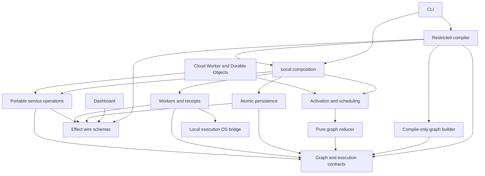
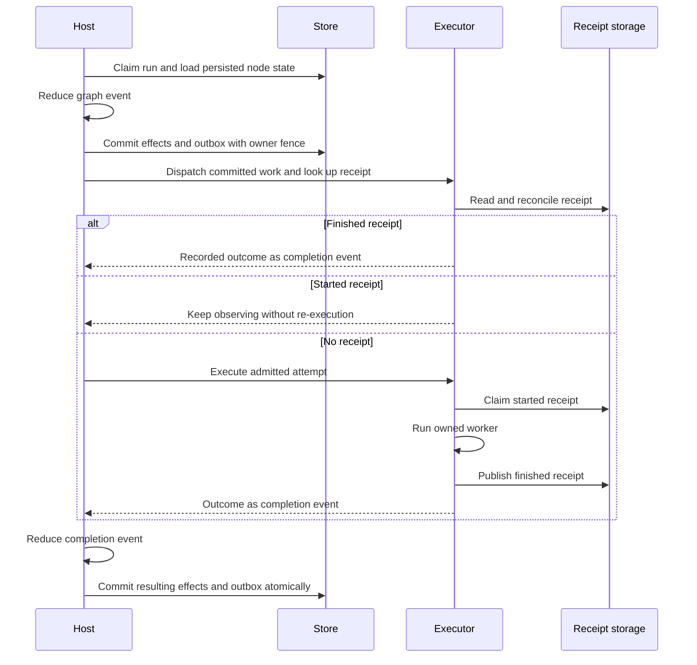
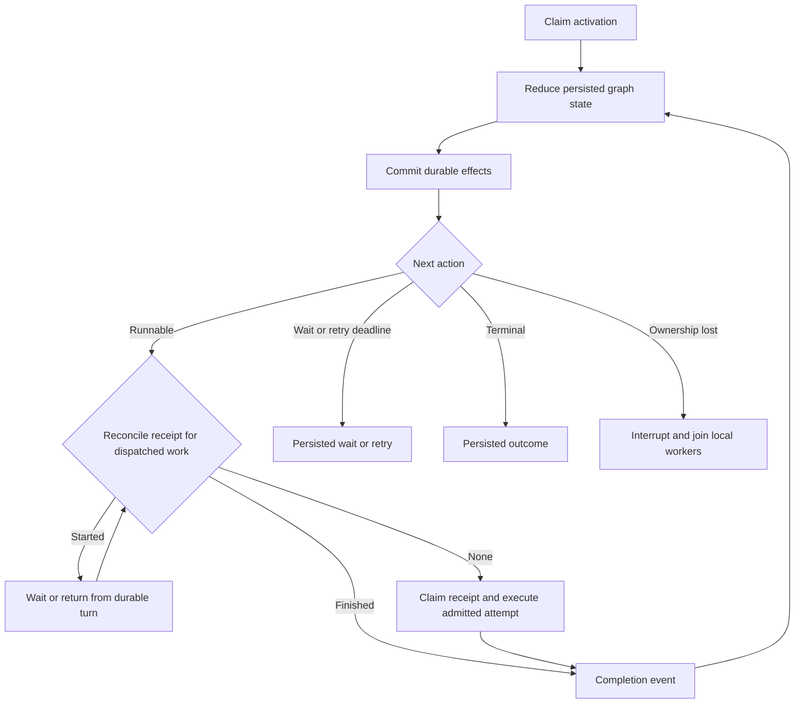

# Loopy

Loopy compiles TypeScript workflow definitions into durable graphs. Save a graph by name, queue a run with typed input, and inspect its executions and logs. Runs pin a graph revision. The host resumes persisted graph state and reconciles execution receipts before dispatching work.

Requires Bun 1.4 or newer. Runtime operations use Effect 4.1.2. The graph builder and reducer remain synchronous.

## Try it

```sh
bun install
bun run check
bun run loopy daemon run
```

Keep the daemon running. Save this as `hello.loopy.ts` in a project with a `loopy` dependency:

```ts
import { format, log, loopy } from "loopy";

export default loopy("hello", {
  input: { name: "string" },
  run: ({ input }) => {
    const greeting = format("Hello, {name}!", { name: input.get("name") });
    log(greeting);
    return { greeting };
  },
});
```

In another terminal:

```sh
bun run loopy graph hello.loopy.ts
bun run loopy save hello.loopy.ts
bun run loopy run hello --name Hatim
bun run loopy runs hello
bun run loopy ui
```

`run` queues work through the daemon API and returns the run record. `ui` prints the authenticated dashboard URL and starts a foreground daemon if needed. A project importing `loopy` needs its own dependency. `bun run install:global` builds and installs a private package archive for CLI use.

## Author graphs

The `run` callback builds a graph during compilation. SDK calls return references to future values. Use `branch`, `switch_`, `map`, `parallel`, `rescue` and `finally_` to construct control flow. Use `code` for separately bundled executable modules and `sh`, `git`, `fs`, `text`, `net` or `archive` for command nodes. The compiler restricts author syntax and evaluates a snapshot; the daemon does not import the author definition.

Input records support `string`, `number` and `boolean`. Suffix an optional field name with `?`. Named CLI flags coerce these types; JSON input is also supported:

```sh
loopy run hello --input-json '{"name":"Hatim"}'
loopy run hello --input-file input.json
```

Choose one input source. Use `--key=value` for dash-prefixed values or `-- --key value` for input names that collide with command options. Definitions may set description, mode, scope, declared secrets and schedule. The defaults are project scope and sandbox mode. Saving a new version leaves existing runs pinned to their original graph and bundles.

The workflows under `examples/` still use the removed executable step SDK. Their migration belongs to PR 7; they are not runnable examples of the current builder. The graph fixtures under `packages/loopy/_tests_` exercise the current API.

## Run, inspect and schedule

```sh
loopy list
loopy inspect <run-id>
loopy logs <run-id> --follow
loopy resume <run-id>
loopy cancel <run-id>
loopy hook <run-id> approve --payload '{"approved":true}'
loopy schedule hello --cron '0 9 * * 1-5' --tz Asia/Kolkata --input-json '{"name":"Hatim"}'
loopy schedule hello --disable
loopy schedule hello --enable
loopy schedule hello --off
```

Data commands use authenticated daemon HTTP. Only daemon control opens local SQLite. Resume wakes a claimable run; it does not reset terminal outcomes. Cancellation rejects actively owned runs and unfinished executions or started graphs whose finally cleanup cannot yet be driven safely.

`wait` nodes persist hook registrations and optional deadlines. `sleep` nodes persist wake times. Neither requires a timer to remain alive while the run is suspended. Schedules retain their workspace and use optimistic versions; missed fires are not backfilled. Keep the daemon running to claim queued and due work.

The dashboard shows definition source and graphs, revision-pinned runs, execution attempts, logs and schedules. Lists use bounded pages. A transaction event stream updates caches, resumes from cursors and refetches after cursor expiry or a store epoch change. API destinations are configured at build time, not through URL query parameters. Tokens stay scoped to the selected API; requests omit cookies and reject redirects.

## Execution and recovery

The host persists an execution before dispatch and fences completions by execution key and attempt. Store writes require the current owner token. Node writes, waits, retry deadlines, outcomes and event outbox entries commit atomically.

Workers claim an exclusive started receipt and publish a finished receipt atomically. A finished receipt wins during reconciliation. A confirmed-dead worker with only a started receipt becomes `uncertain`; Loopy does not repeat that attempt. An interrupted transport remains an infrastructure failure instead of becoming a retryable business error. An external side effect may have happened before interruption, so inspect uncertain results before starting replacement work.

Local activation owns its worker fibers and joins cleanup before releasing ownership. Graceful daemon stop drains active work. Ownership loss interrupts local workers. Durable cloud activation returns after a bounded turn and retains provider ownership for later reconciliation.

Graph failures are outcome values. Infrastructure errors use tagged Effect error channels. Defects, interruption and cleanup failures retain their Causes where composition needs them; they are not classified by matching message text. Worker wire diagnostics are bounded and do not serialize the entire in-process Cause.

## Architecture

Public entries are `loopy` and `loopy/graph` for authoring, `loopy/engine` for the reducer, `loopy/local` for local composition and `loopy/contract` for browser-safe wire schemas. There is no `loopy/runtime` entry.



| Module | Owns |
| --- | --- |
| `core`, `contract` | Domain contracts, tagged errors and shared Effect Schema codecs |
| `engine` | Pure graph transitions, references and retry policy |
| `host` | Activation lifetime, leases, admission, scheduling and reconciliation |
| `store` | Atomic state changes, queries and transaction event delivery |
| `executor` | Worker dispatch, bounded protocol and durable receipts |
| `compiler`, `sdk` | Restricted graph construction and executable artifact production |
| `service` | Portable operations over injected persistence and registries |
| `local`, `cli` | Files, processes, scoped daemon composition and HTTP commands |
| `apps/cloud`, `apps/sandbox` | Provider adapters, durable turns and sandbox attempt supervision |

Modules expose operations that hide their transaction, resource or protocol details. Effect factories and layers acquire resources at composition boundaries. Memory stores, fake executors and injected clocks exercise the same contracts as production adapters. Cross-layer imports go through the target module's index and are enforced by the architecture test.





## Secrets and local state

```sh
loopy secrets set NPM_TOKEN
loopy secrets set NPM_TOKEN --stdin
loopy secrets list
loopy secrets remove NPM_TOKEN
```

Declare secret names in the definition. The executor reads one validated snapshot, injects only declared values and redacts them from command diagnostics. Missing secrets prevent receipt claim and execution. The secret file is plaintext with user-only permissions. Inputs, argv, explicit environment, stdin and results are persisted; keep credentials out of those fields.

Sandbox mode denies network and restricts filesystem access using platform sandbox tools. Executable bundles retain filesystem restrictions even when full mode permits network. Unsupported or failed sandbox launches do not fall back to broader permissions. Only save trusted source and executable modules.

`--home` or `LOOPY_HOME` selects the home containing registry metadata, historical graphs, captured sources, bundles, receipts, secrets and `runs.sqlite`. Project lookup selects the nearest ancestor with `.loopy/loopies`. A slug belongs to its canonical source file; `save --replace` transfers that ownership. SQLite schema 15 upgrades schemas 13 and 14 atomically and rejects unsupported populated databases without resetting them.

`loopy daemon install` installs a user service through launchd or systemd. `daemon status` reads private discovery metadata; `daemon uninstall` removes the service. Pass an absolute `--home` to select isolated state. Logs append to `<home>/logs/daemon.log`.

## Development

Run `bun run check` before pushing. It builds the package and dashboard, checks lint and types, then runs package, dashboard and workload tests. Tests use temporary homes, explicit registry markers and injected dependencies. Real Docker acceptance is opt-in; local workerd coverage does not establish deployed-provider acceptance.

After changing the core or runtime, also run `bun run acceptance:local`. This executes checked-in loopies through the real CLI and an isolated daemon, verifies their results, and retains evidence under `.loopy/acceptance`. It is a separate acceptance run, not part of `bun test`. See [the local acceptance suite](scripts/acceptance/README.md) for cases, reports and coverage limits.

See [AGENTS.md](AGENTS.md) for module ownership, [the cloud README](apps/cloud/README.md) for provider boundaries and [the sandbox README](apps/sandbox/README.md) for retained receipt rules.
