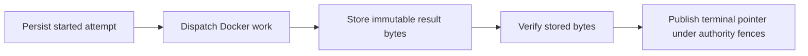

# Local cloud integration

Phase 1 runs a Cloudflare Worker, SQLite Durable Object per workspace, R2 artifact storage and Durable Object alarms through Wrangler local emulation. A Bun service starts isolated Docker workers through an asynchronous attempt API. Both hosts compose the portable `service/` layer for mutations, queries, schedules and wire views. The dashboard uses the same HTTP and SSE contracts as the local daemon.

This branch is local only. The Worker rejects remote hosts and non-local stage configuration. No deployment script or CI deployment job is installed. Real Cloudflare resources, Modal workloads and personal data migration require Hatim's separate phase 2 approval. That approval does not authorize merging this branch.

## Start

Use an isolated checkout. The transport-failure runner records the worktree, branch and HEAD it ran from. Bun 1.4.0 and Docker CLI 29.8.1 were used. The lockfile pins Wrangler 4.152.0, Miniflare 4.20260730.0 and Cloudflare types 5.20261022.1. The Worker compatibility date is 2026-07-30.

```sh
bun install --frozen-lockfile
colima start loopy-cloud-phase1 --activate=false --cpu 2 --memory 3 --disk 16 \
  --mount none --ssh-agent=false --ssh-config=false --template=false
bun run cloud:build-sandbox
bun run cloud:start
```

Run the Colima command only for this named profile. It creates a dedicated VM without host mounts and leaves the default Docker context alone. The image uses `oven/bun:1.4.0`. Its build stage installs the private core, contract, SDK and runtime workspace dependencies locally and bundles both workers into standalone files. No personal home, Docker socket or host secrets are mounted into execution containers.

The start command checks all four ports before launching anything. An occupied port is an error, not permission to stop its owner.

| Service | Address |
| --- | --- |
| Worker API | http://127.0.0.1:14870 |
| Docker attempt service | http://127.0.0.1:14871 |
| Dashboard | http://127.0.0.1:14872 |
| Wrangler inspector | 127.0.0.1:14873 |

In a second terminal, print the disposable dashboard URL and open it in personal Chrome:

```sh
bun --no-env-file apps/cloud/dev/open-url.ts
```

The URL contains a bearer credential in its fragment. Do not paste it into chat, reports or commits. Fixture credentials live in private ignored `.loopy/cloud/local.json`. The starter passes only a small environment allowlist to its children and runs Wrangler with `--local`. Existing ports 4310 and 4173 and personal `~/.loopy` are unused by this setup.

## Exercise

```sh
bun --no-env-file apps/cloud/dev/journey/index.ts
bun --no-env-file apps/cloud/dev/journey/artifact.ts
bun --no-env-file apps/cloud/dev/failures/index.ts
env -i PATH="$PATH" HOME="$HOME" LANG=C.UTF-8 \
  bun --no-env-file apps/cloud/dev/transport-failure/index.ts
bun run check
```

The ordinary journey creates fresh fixture runs on the main local stack. It compiles safe definitions, transfers verified bundles and source, exercises both branches, map/parallel work, a controlled retry, logs, approval, historical revision execution, auth isolation, bounded pages and SSE reconnection. JSON evidence goes to `.notes/cloud/evidence`.

The failure journey starts its own local processes on 14970, 14971 and 14973. It uses `.loopy/cloud-failures/runtime-root` and a different Docker ownership hash. It kills only its recorded processes and labelled fixture workers, restarts persisted state, and checks uncertainty, timeouts and real overlapping cron firings. It removes its own Docker resources and stops its own processes after the run. It needs several minutes because cron ticks are real.

The transport journey opens no ports. It kills an actual Docker wait client and directs selected inspect/list calls to an absent socket while the owned worker keeps running. It checks original-container reconciliation, duplicate admission and the persisted timeout deadline, then removes only its receipt-derived resources. State remains under `.loopy/cloud-transport`. The shared Docker daemon and fixture stack stay available. This proves invocation-scoped CLI failures, not a Docker daemon outage.

See [AGENTS.md](../../AGENTS.md#tests-and-isolation) for test roots and fixture isolation.

## Receipt authority and configuration

The ordinary `cloud:start` stack and sandbox CLI use filesystem receipt authority. The `apps/cloud/dev/playground` default profile also uses filesystem authority; its `architecture` profile injects Durable Object authority over HTTP. These profiles have separate ports and state roots. The CLI has no DO-mode flag. A DO-backed harness supplies an explicit dependency factory to `startSandbox`; the factory runs only after state-root validation and process-lock acquisition. Authority selection must use a fresh root rather than reinterpret populated filesystem receipts or export guards.

`apps/cloud/wrangler.jsonc` declares these local-emulation bindings:

| Binding | Owner |
| --- | --- |
| `WORKSPACES` | `Workspace` DOs own workflow runs, schedules and outbox transactions. |
| `ARTIFACTS` | R2 holds immutable graphs, bundles and source. |
| `SANDBOX_RECEIPTS` | `SandboxReceipts` DO owns attempt records, session epochs and export guards for the configured namespace. |
| `RECEIPT_RESULTS` | R2 holds immutable, content-addressed terminal result bytes. |

Migration `v2-receipts` adds the SQLite-backed `SandboxReceipts` class. It is separate from the workflow workspace DO. The bridge uses `POST /internal/sandbox-receipts`, accepts loopback HTTP in local stage, rejects browser `Origin` requests and requires a private bearer credential plus `X-Loopy-Receipts-Namespace`.

For DO mode, configure `RECEIPTS_TOKEN`, `RECEIPTS_NAMESPACE` and `RECEIPTS_ROOT` together. With only some of them set, every API request fails with an internal error; with none set, the receipt route answers 404. The token must be 32 to 256 characters and differ from all `LOCAL_AUTH` user tokens. The namespace is 1 to 256 letters, digits, underscores or hyphens. The root is the bridge's canonical absolute sandbox state root, with no empty, `.` or `..` components. The bridge client sends the matching namespace header. The Worker authenticates each bridge command, and the DO trusts what the Worker forwards. The DO persists the namespace/root pair and rejects changes to it. Keep credentials in private ignored configuration; never copy generated vars, tokens or credential-bearing URLs into reports or commits.

The authority serializes admission, completion and export exclusion. DO sessions persist a monotonically increasing epoch plus a nonce, fencing stale writers across bridge restart. Filesystem authority relies on the OS process lock and a process-local session; it does not claim a persistent epoch. Neither mode treats loss of an acknowledgement as permission to repeat a started attempt.

Completion first stores immutable result bytes, then verifies their size, hash and schema before publishing a terminal pointer. DO verification reads R2 outside the SQL transaction and rechecks session/request/terminal authority inside the publication transaction. Result reads verify the reference again. Missing or corrupt bytes fail closed without reopening a terminal attempt. Export guards block same-volume admission until removal of the exact owned helper is confirmed, including after restart.



## State and shutdown

`.loopy/cloud/wrangler` holds emulated SQLite/R2 state. In filesystem mode, `.loopy/cloud/sandbox` holds process locks, attempt records in `receipts/`, immutable result files in `results/`, and active/released export records in `exports/`. In DO mode, the selected profile's Wrangler state holds receipt SQL and result R2; the bridge root still owns its process lock and Docker identity. The named Docker daemon holds input and run volumes. Tokens, generated environment files, process records and logs stay under ignored state roots. The committed evidence contains fixture IDs and assertions, never credentials.

Press Ctrl+C in the `cloud:start` terminal. The parent sends SIGTERM to its three children. The sandbox stops monitoring while preserving started receipts, which it reconciles on restart. Then, when no other phase 1 test is using the dedicated VM:

```sh
colima stop loopy-cloud-phase1
```

This stops compute and retains state for the next start. Stopped containers and named volumes are intentional inspection evidence. It is not a data reset. Do not run `docker system prune`, remove receipt/result/export/session records, delete the whole Colima profile or erase Wrangler state as routine teardown. Losing admission records can permit re-execution; losing result files breaks terminal reads; losing export guards can release a volume before helper cleanup. Resource cleanup must derive an exact allowlist from this authority's records, verify ownership labels and confirm each removal, as the failure journey does. Preserve the records when removing container resources. Stop only the identity-verified stack you own; an occupied port never authorizes stopping another service.

## Retained data

Cloud summary repair serves accepted pointers saved before summary projections existed. Remove that path only after every retained workspace's current pointers have generation-matched projections. Preserve publication generation fences and historical evidence throughout; deleting data is not migration. Filesystem receipt compatibility belongs to the [sandbox README](../sandbox/README.md#retained-data).

## Runtime boundaries

- One workspace DO keeps schedule advancement/run creation, node effects, ownership fencing, waits and event outbox transactions together. Its SQL driver uses synchronous transactions; provider and R2 calls happen outside them.
- Immutable graph/bundle/source writes precede mutable registry publication. Current definitions are capped at 1,000 and 32 MiB combined graph bytes, with 1 MiB per graph. Failed publication may leave unreferenced R2 objects. No garbage collector is provided yet.
- Alarms recover persisted work. Interrupted suspension releases stranded ownership after the lease fence. A bad schedule is isolated from unrelated runs. Invalid saved input disables the schedule; transient failures retry with a persisted deadline. `GET /api/cloud/status` reports turn errors, schedule failures and the last scheduler failure.
- Schedule firing, turn deadlines and schedule failures belong to the runtime host and store, which the local daemon shares. Cron fires may overlap. Missed ticks coalesce to one run with the next deadline calculated from current time. There is no replay of every missed tick. Retry waits retain activation capacity; approval and sleep suspension release it.
- Each attempt is persisted before dispatch. Duplicate provider requests join the same receipt. Unknown transport outcomes remain started while the original container is reconciled. A dead worker without a valid terminal result fails uncertain and is not automatically repeated. This does not promise exactly-once external side effects.
- Rate-limit acquisition is conservative. A transport failure after acquisition can consume quota even if provider admission did not happen. Reconciliation does not refund an ambiguous acquisition.
- `GET /api/cloud/artifacts` takes JSON execution `key`, positive `attempt` and relative `path`. It requires a terminal run in the authenticated workspace. Reads are capped at 1 MiB and reject traversal, symlinks and special files. The result is the current run workspace file, not an immutable per-attempt snapshot.
- Receipts, source and logs contain only synthetic fixtures here. Declared workflow secrets, full mode, type generation and cross-workspace aggregation are not supported by the phase 1 API.

## Limits of this evidence

Local workerd exercises actual APIs but cannot prove Cloudflare regional failover, replicated durability, billing, PITR or production capacity. Docker tests cannot prove Modal sandbox identity, creation idempotency, network isolation or volume commit semantics. SSE keeps an object active and has a cloud duration cost. Whole transactions are retained or pruned together, so replay can require a fresh snapshot after retention.

The engine still materializes activation state and traverses the graph within each bounded turn. Per-turn dispatch budgets are not a 10,000-node execution throughput proof. Metadata listings are capacity-bounded rather than paged. Production auth, workflow secret storage, artifact retention/GC and a real Modal adapter remain phase 2 work behind the approval gate.

Current test outcomes and unresolved acceptance items are recorded in [the evidence log](../../.notes/cloud/EVIDENCE.md), with independent reports beside it.
